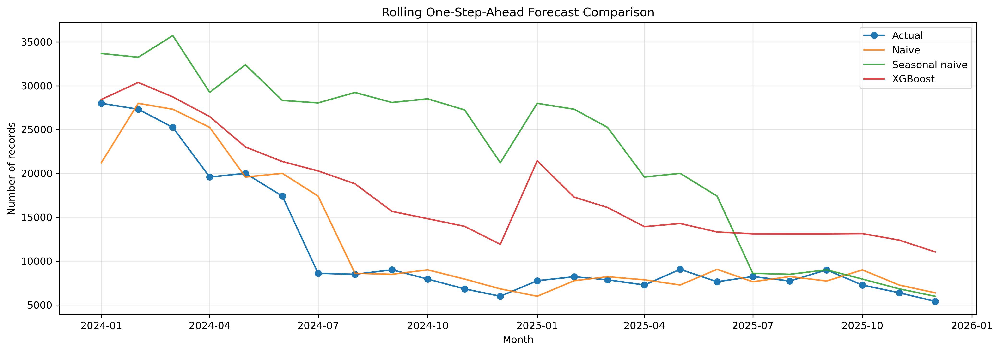
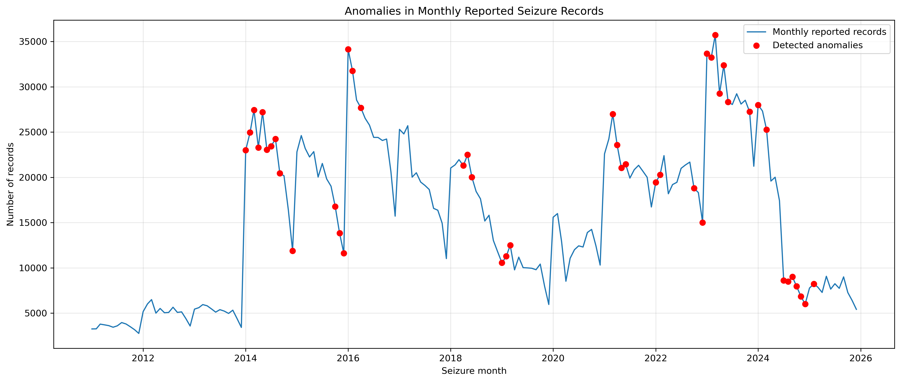
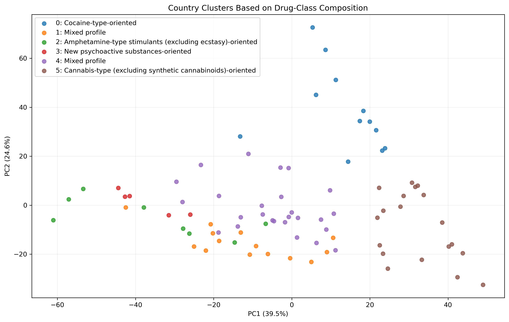
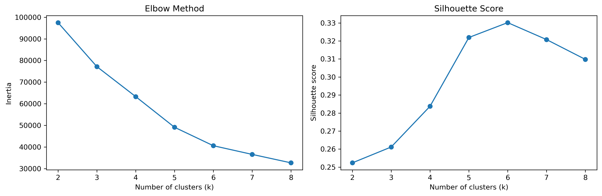

# Every Seizure Is a Signal

**Turning individual drug seizure records into analytical signals through data engineering, forecasting, anomaly detection and unsupervised learning.**

## Project Overview

The United Nations Office on Drugs and Crime (UNODC) Individual Drug Seizures (IDS) dataset provides detailed records of drug seizures reported by countries around the world. However, transforming millions of heterogeneous records into structured, comparable and analytically useful information presents several challenges.

*Every Seizure Is a Signal* develops a reproducible data pipeline and analytical framework to explore temporal patterns, identify unusual changes in reported seizure activity, and examine similarities in the composition of reported seizures across countries.

The project combines data engineering, SQL, DuckDB and Python-based analytics to transform raw seizure records into structured data and interpretable findings.

**Research question:** Can patterns in reported individual drug seizures reveal changes in trafficking activity across countries and over time, and how can data analytics help turn these observations into useful signals?

## Dataset

The project uses the UNODC Individual Drug Seizures (IDS) dataset, containing individual seizure records reported by national authorities.

The processed dataset contains approximately **2.84 million records**, covering seizures dated between **1 January 2011 and 30 June 2026**.

The data were ingested from multiple Excel workbooks and standardised into a consolidated analytical dataset.

### Data characteristics

- Approximately 2.84 million individual records.
- 2011–2026 coverage, with 2026 representing a partial year.
- 147 distinct reporting country codes.
- 345 distinct drug/substance labels in the main dataset.
- Drug classifications and subgroups linked through a reference dataset.

The project preserves the original source-row grain. Since the available data do not provide an official unique seizure-event identifier, repeated-looking records are not automatically removed as duplicates.

Quantities are also kept alongside their measurement units. They are not aggregated across incompatible units.

### Analytical time windows

Different time windows are used depending on the analytical objective:

| Analysis | Period | Scope |
|---|---|---|
| Data validation | 2011–2026 | Annual source-year coverage |
| Forecasting | 2011–2025 | Monthly seizure-record counts |
| Anomaly detection | 2011–2025 | 180 monthly observations |
| Country clustering | 2011–2025 | 84 countries with at least 500 records |

The 2026 observations are partial and are not directly comparable with complete calendar years.

## Data Engineering and Architecture

The project follows a structured pipeline to transform raw source files into an analytical database.

### 1. Data ingestion and preparation

The original Excel workbooks are ingested and consolidated using Python and pandas.

The preparation process includes:

- Standardisation of column names and data types.
- Parsing seizure dates and quantities.
- Cleaning and standardising text fields.
- Retaining source metadata, including source year, file and sheet.
- Harmonisation of country and drug identifiers.
- Data-quality checks for missing values, invalid formats and unusual quantities.
- Creation of a consolidated Parquet dataset.

### 2. Data quality and validation

Data-quality checks are performed before and after loading the data into the database.

These include:

- Missing-value analysis.
- Country-code validation.
- Drug classification and reference matching.
- Duplicate-looking record inspection.
- Quantity and measurement-unit checks.
- Record-count reconciliation between staging and final tables.
- Primary-key and foreign-key validation.

The objective is to preserve the information contained in the original records while ensuring that the resulting analytical structure is consistent.

### 3. Database design: DuckDB star schema

The processed data are organised in a relational star schema using DuckDB.

The database consists of one fact table and three main dimensions:

| Table | Description |
|---|---|
| `fact_seizure` | Individual seizure records, retaining the original source-row grain |
| `dim_date` | Calendar attributes associated with seizure dates |
| `dim_country` | Standardised country identifiers and attributes |
| `dim_drug` | Drug/substance names, groups and classifications |

Additional supporting tables include `ids_staging` and `drug_reference`.

SQL scripts are used to create the schema, validate relationships and perform analytical queries.

## Analytical Methodology

The analytical component focuses on three complementary approaches: forecasting, anomaly detection and country clustering.

### 1. Forecasting reported seizure records

The forecasting task examines whether historical patterns can help predict monthly changes in the number of reported seizure records.

Three models are compared:

- **Naive baseline:** uses the previous month's observed count as the prediction.
- **Seasonal Naive:** uses the observation from the same month in the previous year.
- **XGBoost regression:** incorporates calendar features, cyclical month representations, lagged observations and rolling averages.

The final 24 months are reserved as a holdout test period. Model performance is evaluated using Mean Absolute Error (MAE) and Root Mean Squared Error (RMSE), alongside expanding-window time-series cross-validation.

The evaluation follows a rolling one-step-ahead approach: actual observations from earlier months in the test period are available when constructing subsequent lag features. It is not a fixed 24-month-ahead forecast.

**Results**

The Naive baseline outperforms both more complex alternatives.

| Model | Holdout MAE | Holdout RMSE |
|---|---:|---:|
| Naive | **1,790** | **2,787** |
| XGBoost | 6,244 | 6,855 |
| Seasonal Naive | 10,959 | 13,275 |

Cross-validation confirms the same ranking, with an average MAE of approximately 2,319 for the Naive model, compared with 3,483 for XGBoost and 8,645 for Seasonal Naive.

These results suggest that recent observations provide a strong baseline for predicting monthly reported record counts. In this modelling setup, additional model complexity does not translate into improved predictive performance.



### 2. Anomaly detection

The anomaly-detection analysis aims to identify unusual changes in the monthly seizure-record series.

The methodology combines:

1. Monthly aggregation of seizure records.
2. Seasonal-Trend decomposition using LOESS (STL), with a 12-month seasonal period and robust fitting.
3. Robust Z-score calculation based on the median absolute deviation (MAD).
4. Identification of observations exceeding an absolute robust Z-score threshold of 3.5.
5. Country-level investigation of the flagged months.

**Results**

The analysis identifies **46 anomalous months out of 180 observations** between 2011 and 2025.

The country-level investigation indicates that a relatively small number of reporting countries frequently contribute the largest share of records during anomalous months. Colombia is the leading contributor in most flagged months, with Italy and Sweden also featuring prominently.

This suggests that unusual changes in the global series can be strongly influenced by changes in the reporting contribution of individual countries.

These anomalies are statistical signals in the reported data, not confirmed exceptional trafficking events.



### 3. Country clustering

The clustering analysis explores similarities between countries based on the composition of their reported seizure records.

The process consists of:

1. Aggregating records by country and drug class.
2. Retaining countries with at least 500 records during 2011–2025.
3. Transforming drug-class counts into within-country composition shares.
4. Applying K-Means clustering.
5. Comparing candidate cluster counts using inertia and silhouette scores.
6. Using Principal Component Analysis (PCA) to visualise country profiles.
7. Creating an interactive geographical representation of cluster assignments.

Six clusters are selected from the tested alternatives (k = 2–8), with a silhouette score of approximately **0.330**.

**Results**

The 84 countries are grouped into six descriptive profiles:

| Cluster profile | Countries |
|---|---:|
| Cannabis-oriented | 19 |
| Cocaine-oriented | 12 |
| Amphetamine-oriented | 8 |
| NPS-oriented | 5 |
| Mixed profile | 26 |
| Mixed profile | 14 |

The results reveal variation in the composition of reported seizure records across countries. Some clusters are characterised by a relatively high share of a particular drug class, while others exhibit more diversified compositions.

The silhouette score indicates moderate cluster separation. Therefore, these profiles should be interpreted as broad compositional similarities rather than sharply distinct country groups.





**Interactive map:** [Explore country clustering results](reports/figures/country_clusters_map.html).

## Key Findings

The three analytical components provide complementary perspectives on the reported seizure data.

1. **Recent observations provide a strong forecasting baseline.** The Naive model outperforms XGBoost and Seasonal Naive, highlighting that additional model complexity does not necessarily improve predictive performance.

2. **Global anomalies can be strongly influenced by national reporting patterns.** The 46 flagged months show that changes in the contribution of individual reporting countries can have a substantial influence on the global time series.

3. **Countries exhibit different reported seizure compositions.** The six clusters identify broad similarities in drug-class composition, alongside a substantial group of countries with more mixed profiles.

Together, these findings demonstrate how data engineering and complementary analytical methods can help transform a large, heterogeneous collection of seizure records into structured and interpretable information.

## Limitations and Interpretation

The results must be interpreted in light of the characteristics and limitations of the underlying dataset.

- **Reporting coverage:** The number of records varies across countries and years. Changes may reflect differences in reporting participation, practices and coverage, as well as changes in seizure activity.
- **No direct market measurement:** The dataset does not directly measure the total volume of drug trafficking, drug availability or market prevalence.
- **No trafficking-route inference:** The available fields do not provide a complete origin–destination country-pair structure. Country-level patterns should not be interpreted as trafficking routes.
- **Incomplete transportation information:** Transportation-mode information is unavailable for a large share of records, limiting its analytical usefulness.
- **Measurement units:** Quantities expressed in different units cannot be meaningfully aggregated without appropriate standardisation.
- **Anomaly interpretation:** Statistical anomalies require contextual investigation and should not be treated as confirmed trafficking events.
- **Clustering interpretation:** Cluster assignments depend on the analysed period, inclusion threshold, drug classification and modelling choices. The moderate silhouette score cautions against over-interpreting cluster boundaries.
- **Partial 2026 coverage:** The available 2026 records cover only part of the year and should not be directly compared with complete annual observations.

## Repository Structure

```text
seizure-signals/
│
├── data/
│   ├── raw/                 # Original source workbooks
│   └── processed/           # Consolidated datasets and DuckDB database
│
├── notebooks/
│   ├── 01_data_ingestion.ipynb
│   ├── 02_data_quality.ipynb
│   ├── 03_star_schema.ipynb
│   ├── 04_forecasting.ipynb
│   ├── 05_anomaly_detection.ipynb
│   └── 06_country_clustering.ipynb
│
├── sql/
│   ├── 01_data_quality.sql
│   ├── 02_create_star_schema.sql
│   ├── 03_create_regional_view.sql
│   ├── 04_overall_and_drug_analysis.sql
│   ├── 05_geographical_analysis.sql
│   └── 06_transportation_and_temporal_analysis.sql
│
├── reports/
│   ├── figures/             # Figures and interactive map
│   ├── results/             # Analytical CSV outputs
│   └── final_report.pdf     # Final project report
│
├── requirements.txt
├── .gitignore
└── README.md
```

## Reproducibility

### Requirements

- Python 3.10 or later (recommended).
- JupyterLab or Jupyter Notebook.
- Dependencies listed in `requirements.txt`.

### 1. Clone the repository

```bash
git clone <YOUR_GITHUB_REPOSITORY_URL>
cd seizure-signals
```

### 2. Create a virtual environment

```bash
python -m venv .venv
```

Activate it on Windows PowerShell:

```powershell
.venv\Scripts\Activate.ps1
```

Or on macOS/Linux:

```bash
source .venv/bin/activate
```

### 3. Install dependencies

```bash
python -m pip install --upgrade pip
python -m pip install -r requirements.txt
```

### 4. Obtain the data

Obtain the original IDS source workbooks from the official UNODC data portal.

Place the downloaded files in `data/raw/` and follow the ingestion and preparation notebooks to generate the processed dataset and DuckDB database.

The raw workbooks, processed microdata and local database are excluded from version control.

### 5. Run the analysis

Run the notebooks in numerical order, following their documented dependencies and path configuration.

The SQL scripts provide the database creation, validation and analytical queries. The Python notebooks perform the data preparation, forecasting, anomaly detection and clustering analyses.

Figures and analytical outputs are saved in the `reports/` directory.

## Data Source and Acknowledgement

**Source:** United Nations Office on Drugs and Crime (UNODC), Individual Drug Seizures (IDS) dataset.

Users should obtain the data from the official UNODC data portal and review the applicable terms of use and attribution requirements before reuse or redistribution.

The raw source workbooks and processed microdata are not included in this repository.

## Project Status

The data ingestion and preparation pipeline, DuckDB star schema, SQL analyses, forecasting, anomaly detection and country clustering components have been implemented.

The project is currently in its documentation and reporting stage, consolidating the analytical findings into a final report.

---

*This is an independent analytical project. It does not represent an official UNODC analysis or endorsement.*
